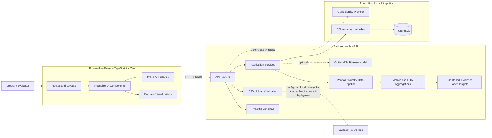
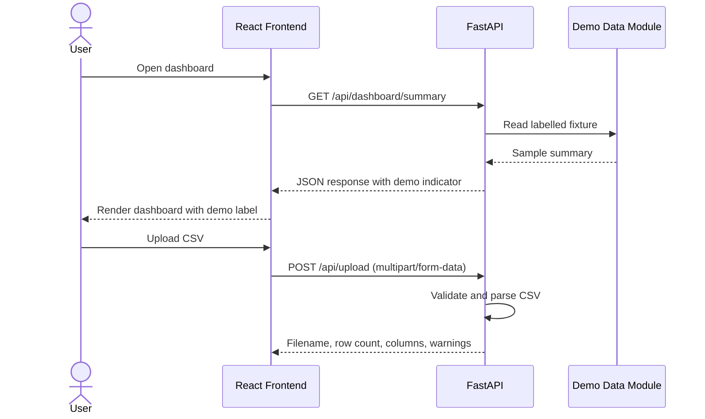
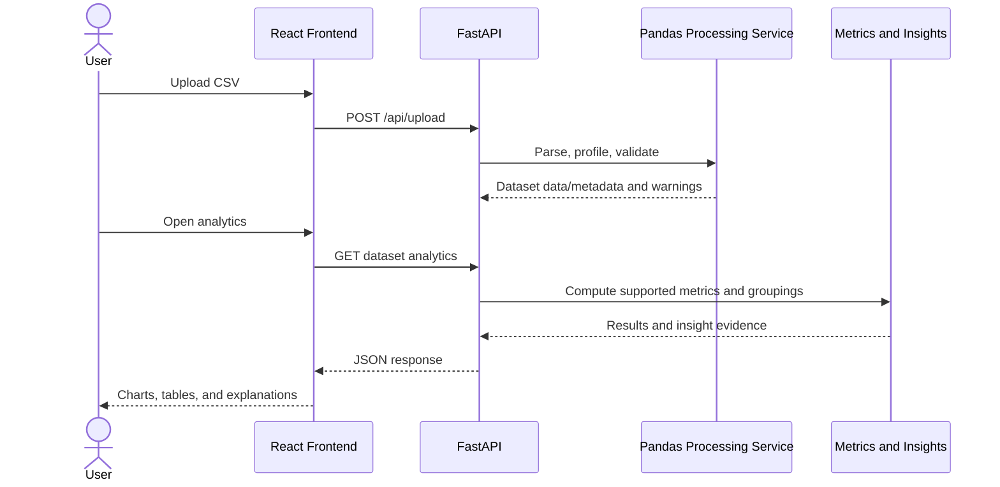
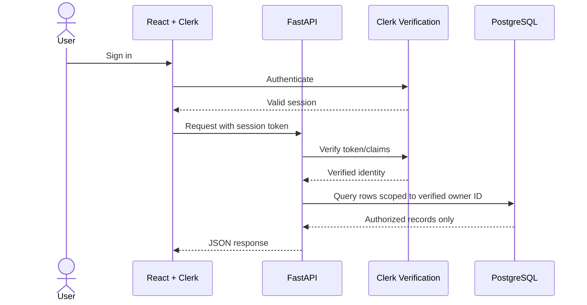
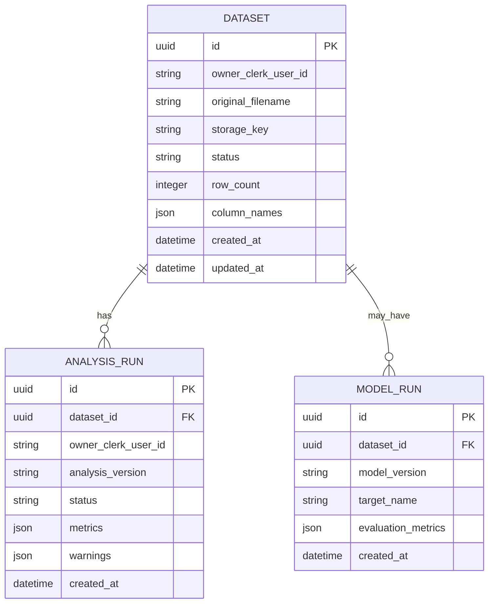

# CreatorLens — System Architecture

**Document status:** Proposed architecture  
**Version:** 1.0  
**Last updated:** 14 October 2026

> This is the intended architecture, not a statement that all components have already been implemented. Clerk and PostgreSQL belong to the later authentication/persistence phase.

## 1. Architecture Goals

- Keep the web interface, API, data processing, and persistence concerns separate.
- Start small enough for a student mini project while allowing the data-science pipeline to grow.
- Use actual uploaded data for analytics and clearly label any demo fixtures.
- Make analysis reproducible and API responses predictable.
- Introduce authentication and persistent user-owned data after the basic application and analytics are working.

## 2. High-Level Component Diagram

## 3. Architectural Layers

### 3.1 Frontend

**Responsibilities:** render pages, accept user input, display validation, show charts and summary cards, and communicate with the API.

**Technology:** React, TypeScript, Vite, Tailwind CSS, React Router, Recharts, Lucide React.

**Key modules:**

- `pages/`: Landing, Dashboard, Upload, Analytics, Insights, Predictions, Settings.
- `layouts/`: main application shell, sidebar, and top navigation.
- `components/`: reusable KPI cards, charts, tables, filters, upload components, and state displays.
- `services/`: one shared API client and endpoint functions.
- `types/`: typed request/response interfaces.
- `data/`: demo fixtures only, clearly identified as illustrative.

The frontend is not the source of truth for analytics or authorization. It may hide routes for UX, but backend security must still protect the data.

### 3.2 API and Application Layer

**Responsibilities:** accept requests, validate inputs, enforce file limits, call services, shape responses, and provide consistent errors.

**Technology:** FastAPI, Pydantic, Uvicorn.

Route handlers should remain thin. Heavy CSV logic and analytics should live in testable service functions. FastAPI's generated OpenAPI page is useful during local development, but it should not expose sensitive values.

### 3.3 Data Processing Layer

**Responsibilities:** parse the CSV, profile columns, standardize names, handle data-quality issues, calculate supported metrics, aggregate results, and create traceable insights.

**Technology:** Pandas and NumPy; Scikit-learn/Joblib only for an evaluated model.

The pipeline should be schema-aware. If a file does not contain views, the API should not return a real views-based engagement rate. If a date column is missing or unparseable, time-series analysis should explain why it is unavailable rather than returning invented trends.

### 3.4 Persistence Layer — Phase 3

**Responsibilities:** persist dataset metadata and analysis records, associate records with the verified owner, and provide secure retrieval.

**Technology:** PostgreSQL, SQLAlchemy 2.x, Alembic migrations.

For the initial local demo, CSV files may be processed in memory or held in a controlled, gitignored storage directory. PostgreSQL should generally store metadata and references, not large CSV binary content. Deployed file storage can later be swapped behind a storage service abstraction.

### 3.5 Authentication Layer — Phase 3

**Responsibilities:** handle sign-up/sign-in/session lifecycle and supply a verified user identity to the backend authorization layer.

**Technology:** Clerk.

The browser obtains a valid session token through the supported Clerk client SDK. FastAPI verifies it server-side according to the current Clerk guidance. The backend derives the user ID from the verified token. All user-owned database and file operations must be scoped to this identity.

## 4. Phased Runtime Architecture

### Phase 1 — Basic interface and backend

The phase-1 dashboard may use mock data; the upload endpoint should validate the actual file. Make this difference clear in the interface and docs.

### Phase 2 — Data science enabled

Where datasets are kept across requests, the backend needs a controlled dataset reference/storage decision. Do not depend on process memory for records that users expect to persist across restarts.

### Phase 3 — Authentication and persistence

Never authorize based only on a `user_id` sent in JSON, URL parameters, or frontend state.

## 5. Proposed Data Model

This is a logical starting point. Confirm exact columns and relationships before generating production migrations.

Design notes:

- Use database-generated UUIDs or another consistent identifier strategy.
- Keep `owner_clerk_user_id` sourced from verified identity. It is an external identity reference and may not be a numeric ID.
- Add indexes for owner and commonly queried foreign-key columns.
- Add foreign keys and migrations.
- Decide whether ownership duplication on `analysis_runs` is useful for safe query scoping; if retained, enforce consistency with the parent dataset.
- JSON/JSONB is suitable for flexible metadata/metric results, but core relations and frequently queried fields should remain typed columns.
- Do not persist every row of an arbitrary CSV into a generic relational table unless a concrete query need warrants that design.

## 6. Key API Boundaries

| Endpoint | Purpose | Initial behavior |
|---|---|---|
| `GET /api/health` | Verify API is responding | Real health response |
| `GET /api/dashboard/summary` | KPI cards | Demo fixture, replaced by computed results in Phase 2 |
| `GET /api/dashboard/trends` | Time-series chart | Demo fixture, then dataset-driven aggregation |
| `GET /api/dashboard/content-comparison` | Category comparison | Demo fixture, then dataset-driven aggregation |
| `GET /api/posts` | Recent post table | Demo fixture, then bounded/paginated data |
| `POST /api/upload` | Validate a CSV | Actual validation and metadata response |
| `GET /api/datasets/{id}/profile` | Dataset profile | Phase 2; authenticated/owner-scoped in Phase 3 |
| `GET /api/datasets/{id}/analytics` | Metrics and aggregates | Phase 2; authenticated/owner-scoped in Phase 3 |
| `GET /api/datasets/{id}/insights` | Computed insights | Phase 2; authenticated/owner-scoped in Phase 3 |
| `POST /api/datasets/{id}/predictions` | Model inference | Only when model is trained, versioned, and evaluated |

Response schemas should be versionable and should identify the result's source, such as `demo`, `uploaded_dataset`, or `saved_dataset`, where useful.

## 7. Data Flow and Ownership

1. User chooses a CSV in the browser.
2. Browser sends the file to FastAPI as multipart form data.
3. Backend validates size/type/content and parses a bounded dataset.
4. Backend returns metadata and warnings; it does not return the full file unnecessarily.
5. Analytics endpoints call the processing services and return aggregates rather than sending excessively large raw tables to the browser.
6. Once persistence is added, the backend stores ownership-linked metadata and an appropriate storage reference.
7. On protected requests, the backend verifies identity and scopes all reads/writes to that owner.
8. Data is visualized by the frontend; insight text comes from actual metrics and remains qualified.

## 8. Security and Privacy Boundaries

- The upload API treats all files and column names as untrusted.
- Apply configurable upload size limits and avoid path traversal by generating storage keys.
- Keep raw/private datasets and uploaded files out of Git.
- Keep `.env` files out of Git and commit only redacted `.env.example` files.
- No secrets in frontend code or `VITE_*` variables.
- Use HTTPS in a deployed environment.
- Use Clerk token verification on the backend for protected endpoints.
- Scope all persistent records and file operations to the verified owner.
- Do not log auth tokens, database URLs, or unnecessary raw dataset values.
- Avoid exposing server file paths and stack traces in API responses.

## 9. Configuration and Deployment Shape

### Local development

- Frontend: Vite development server, commonly port `5173`.
- Backend: Uvicorn/FastAPI, commonly port `8000`.
- API base URL: `VITE_API_BASE_URL`.
- Backend CORS: configured for the actual local frontend origin.
- Optional local uploads: controlled directory, gitignored, with configurable size limits.

### Later deployment

A deployment can host the frontend as static assets and run FastAPI as an API service. PostgreSQL should be a managed or otherwise secured database. Uploaded files should use durable private storage rather than relying on ephemeral application storage. Configure production origins, secrets, migrations, logging, and HTTPS separately from local development.

## 10. Architecture Decisions

| Decision | Reason |
|---|---|
| React + Vite rather than Streamlit | Provides a separate web UI and a conventional frontend/backend boundary. |
| FastAPI for API | Python-native integration with CSV processing and ML libraries. |
| CSV-first input | Avoids dependence on social platform API credentials for the mini project. |
| Data-driven charts | Ensures visualizations reflect the selected dataset rather than static assumptions. |
| ML is conditional | A model should be justified by the available target, sample size, and evaluation, not added only for appearance. |
| Clerk plus PostgreSQL later | Authentication and persistence are isolated until the basic app and analytics are stable. |
| Database stores metadata by default | Avoids placing large raw CSV binaries in relational tables without a clear need. |
| Backend-enforced ownership | A hidden route or client-side user ID is not an authorization boundary. |

## 11. Outstanding Architecture Decisions

- Select and document the final dataset and its license/source.
- Decide whether uploaded data stays in memory, local controlled storage, or object storage for each environment.
- Finalize column mapping and minimum schema requirements.
- Define the supported analysis contract and metric formulas after inspecting the real dataset.
- Decide whether a trained model is justified and define the exact prediction timing/target.
- Confirm the appropriate Clerk token verification method for the selected current SDK and backend setup.
